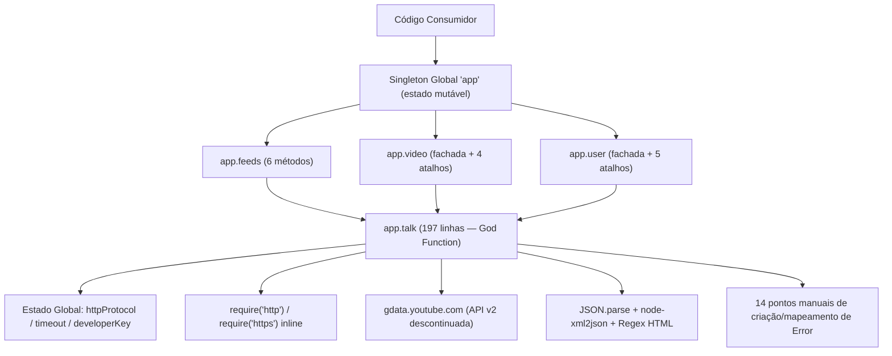

# Diagnóstico Arquitetural — `youtube-feeds` (`nodejs-youtube-1`)

> **Escopo da análise:** Revisão estática completa dos arquivos do repositório (`youtube-feeds.js`, `test.js`, `package.json`, `README.md`, `deprecated.js`, `.bithoundrc` e `.travis.yml`).

---
Ʋ
## 1. Resumo Executivo e Visão Geral da Arquitetura

O projeto `youtube-feeds` (v`2.4.1`) é uma biblioteca Node.js monolítica em ES5 concebida para consultar feeds públicos da **YouTube Data API v2** (`gdata.youtube.com`, oficialmente descontinuada pelo Google em 20 de abril de 2015).

Toda a lógica de negócio, configuração, transporte HTTP, parsing de múltiplos formatos e tradução de erros reside em um único arquivo ([`youtube-feeds.js`](youtube-feeds.js), 332 linhas) que exporta diretamente um objeto singleton mutável (`app`).



### Mapa Sintético de Severidade

| Categoria | Severidade | Evidência Principal |
| :--- | :--- | :--- |
| **Obsolescência e Acoplamento à API v2** | Crítica | Dependência hardcoded de `gdata.youtube.com` e `GData-Version: 2` ([`youtube-feeds.js`](youtube-feeds.js#L148-L166)) |
| **Complexidade Ciclomática e Violação de SRP** | Crítica | `app.talk` concentra 197 linhas (59,3% do módulo), CC agregada até 40 e 6 níveis de aninhamento ([`youtube-feeds.js`](youtube-feeds.js#L133-L329)) |
| **Bugs Lógicos e Falhas de Segurança** | Crítica | Vazamento de `fields.key` na query string ([L154 vs L167](youtube-feeds.js#L154-L168)), condição impossível `x && x === 0` ([L284](youtube-feeds.js#L284)), ausência de `try/catch` em parsers ([L202](youtube-feeds.js#L202), [L221](youtube-feeds.js#L221)) |
| **Acoplamento Arquitetural** | Alta | Estado global mutável, `require` inline de transporte, mutação de argumentos, acoplamento circular entre fachadas |
| **Baixa Manutenibilidade e Testabilidade** | Alta | Ausência de testes unitários offline; [`test.js`](test.js) realiza chamadas reais contra API morta e cobre apenas 3 cenários |
| **Duplicação de Código** | Média/Alta | 15 wrappers de rota repetitivos, 14 construções manuais de `Error`, reatribuição redundante de `complete = true` |
| **Documentação e Divergências** | Média/Alta | Zero JSDoc/tipos no código e 5 divergências concretas entre [`README.md`](README.md) e [`youtube-feeds.js`](youtube-feeds.js) |

---

## 2. Diagnóstico Explícito de Acoplamento

### 2.1 Acoplamento a Estado Global Mutável (Singleton `app`)
* **Onde ocorre:** [`youtube-feeds.js#L13-L17`](youtube-feeds.js#L13-L17), [`L165`](youtube-feeds.js#L165), [`L171`](youtube-feeds.js#L171), [`L306`](youtube-feeds.js#L306) e [`L332`](youtube-feeds.js#L332).
* **Descrição:** O módulo exporta diretamente o objeto literal `app`, onde `httpProtocol`, `timeout` e `developerKey` funcionam como variáveis globais compartilhadas por todo o processo Node.js. A função `app.talk` lê essas propriedades diretamente do escopo do singleton.
* **Impacto:**
  * Impossibilidade de instanciar dois clientes isolados no mesmo processo (por exemplo, com `developerKey`, `timeout` ou protocolo distintos).
  * Efeitos colaterais globais em execução concorrente ou testes: alterar `youtube.httpProtocol = 'https'` ou `youtube.timeout` impacta todas as chamadas em andamento no processo.
  * Impede injeção de configuração por instância (*Dependency Injection*).

### 2.2 Acoplamento Forte à Camada de Transporte HTTP (`http`/`https`)
* **Onde ocorre:** [`youtube-feeds.js#L170-L175`](youtube-feeds.js#L170-L175).
* **Descrição:** A seleção do cliente de rede ocorre dentro da própria função de comunicação por meio de `require ('http')` e `require ('https')` condicionados a `app.httpProtocol === 'https'`.
* **Impacto:**
  * Não há interface ou adaptador de transporte substituível (*Port/Adapter*), inviabilizando o uso de proxies corporativos, `http.Agent` customizado (keep-alive/pool) ou stubs de rede em testes unitários.
  * A suíte [`test.js`](test.js) fica forçadamente acoplada à rede real e ao servidor remoto.

### 2.3 Acoplamento Forte ao Host, Protocolo e Formatos da YouTube Data API v2
* **Onde ocorre:** [`youtube-feeds.js#L148-L166`](youtube-feeds.js#L148-L166) e [`L200-L288`](youtube-feeds.js#L200-L288).
* **Descrição:** O núcleo de comunicação está rigidamente amarrado a detalhes específicos do protocolo GData v2:
  * Hostname fixo `gdata.youtube.com` ([L153](youtube-feeds.js#L153)), cabeçalho `'GData-Version': '2'` ([L158](youtube-feeds.js#L158)), parâmetro `v = 2` ([L149](youtube-feeds.js#L149)), formatos `'jsonc'`/`'json'` ([L148](youtube-feeds.js#L148)) e cabeçalho `'X-GData-Key'` ([L166](youtube-feeds.js#L166)).
  * O parser acopla-se diretamente ao formato interno da API em três representações distintas (JSON-C `data.data` / `data.totalItems`, XML Atom `data.feed.openSearch$totalResults.$t` / `<errors>` e páginas HTML de erro `<H1>...<\/H1>\n<H2>Error ...<\/H2>`).
  * Acoplamento estrutural direto à biblioteca `node-xml2json` ([L10](youtube-feeds.js#L10), [L221-L234](youtube-feeds.js#L221-L234)): o código depende da convenção específica de saída desse parser (chaves em minúsculas como `err.internalreason`, que precisam ser manualmente convertidas para `internalReason`).

### 2.4 Acoplamento Interno e Circular entre Fachadas (`app.video`, `app.user`, `app.feeds`)
* **Onde ocorre:** [`youtube-feeds.js#L64-L87`](youtube-feeds.js#L64-L87) e [`L95-L126`](youtube-feeds.js#L95-L126).
* **Descrição:**
  * `app.video(videoid, cb)` acumula dois papéis: dispara uma requisição imediata se `cb` for função e retorna um objeto com sub-métodos (`details`, `related`, `responses`, `comments`).
  * `details` chama recursivamente `app.video(videoid, cb)` ([L72](youtube-feeds.js#L72)), criando um novo objeto wrapper que é imediatamente descartado; `related`, `responses` e `comments` delegam diretamente para `app.feeds.*` ([L75-L85](youtube-feeds.js#L75-L85)).
  * Da mesma forma, `app.user(userid, cb)` invoca `app.user(userid).profile(cb)` ([L97](youtube-feeds.js#L97)), instanciando o objeto de métodos duas vezes para executar uma única chamada.
* **Impacto:** Dificulta o desmembramento em submódulos independentes e impede mocks isolados de `app.feeds` sem quebrar `app.video`.

### 2.5 Acoplamento por Mutação Direta de Argumentos do Chamador
* **Onde ocorre:** [`youtube-feeds.js#L148-L149`](youtube-feeds.js#L148-L149) e [`L167`](youtube-feeds.js#L167).
* **Descrição:** `app.talk` modifica in-place o objeto `fields` recebido do consumidor (`fields.alt = ...`, `fields.v = 2`, `delete fields.key`).
* **Impacto:** Se o código chamador reutilizar um mesmo objeto de filtros entre múltiplas chamadas (ex.: paginando resultados ou passando `{ key: '...' }`), o objeto original é silenciosamente alterado e perde a propriedade `key` após a primeira chamada.

---

## 3. Duplicação de Código

### 3.1 Repetição Estrutural nos Wrappers de Endpoints (15 métodos)
* **Onde ocorre:**
  * `app.feeds` ([`youtube-feeds.js#L24-L57`](youtube-feeds.js#L24-L57)): 6 métodos repetem a mesma assinatura de repasse `(path, vars, cb)` para `app.talk`.
  * `app.user` ([`youtube-feeds.js#L100-L125`](youtube-feeds.js#L100-L125)): 4 métodos (`favorites`, `playlists`, `uploads`, `newsubscriptionvideos`) repetem exatamente o padrão `function (vars, cb) { app.talk ('feeds/api/users/'+ userid +'/<recurso>', vars, cb); }`.
  * `app.video` ([`youtube-feeds.js#L75-L85`](youtube-feeds.js#L75-L85)): 3 métodos (`related`, `responses`, `comments`) repetem exatamente o mesmo wrapper de delegação para `app.feeds`.
* **Problema:** Ausência de uma tabela declarativa de rotas ou fábrica geradora de métodos de recurso, gerando código repetitivo sempre que um novo endpoint precisa ser exposto.

### 3.2 Duplicação na Construção de `Error` e Controle de `complete`
* **Onde ocorre:** [`youtube-feeds.js#L189-L324`](youtube-feeds.js#L189-L324).
* **Descrição:**
  * Existem **14 pontos distintos** dentro de `app.talk` instanciando `new Error(...)` e atribuindo manualmente propriedades extras (`error.origin` e `error.details`): [L208](youtube-feeds.js#L208), [L214](youtube-feeds.js#L214), [L225](youtube-feeds.js#L225), [L238](youtube-feeds.js#L238), [L249](youtube-feeds.js#L249), [L258](youtube-feeds.js#L258), [L263](youtube-feeds.js#L263), [L268](youtube-feeds.js#L268), [L273](youtube-feeds.js#L273), [L282](youtube-feeds.js#L282), [L286](youtube-feeds.js#L286), [L298](youtube-feeds.js#L298), [L309](youtube-feeds.js#L309) e [L320](youtube-feeds.js#L320).
  * O padrão de guarda de idempotência `if (!complete) { complete = true; ... cb(...); }` é duplicado nos handlers `close` ([L296-L301](youtube-feeds.js#L296-L301)), `setTimeout` ([L307-L313](youtube-feeds.js#L307-L313)) e `error` ([L318-L324](youtube-feeds.js#L318-L324)), além da guarda inicial em `end` ([L189-L193](youtube-feeds.js#L189-L193)).
  * Adicionalmente, dentro de `response.on('end')`, após `complete = true` já ter sido executado na [L192](youtube-feeds.js#L192), a atribuição `complete = true;` é repetida **11 vezes** de forma totalmente redundante (L207, L213, L224, L237, L248, L257, L262, L267, L272, L281, L285).
* **Ausência:** Falta uma função fábrica de erros (ex.: `buildError(message, origin, details)`) e uma função única de finalização (ex.: `onceDone(err, data)`) que centralize `complete` e `cb`.

### 3.3 Duplicação de Verificação em Fachadas e Boilerplate em `test.js`
* **Onde ocorre:**
  * [`youtube-feeds.js#L65`](youtube-feeds.js#L65) e [`L96`](youtube-feeds.js#L96) duplicam a lógica de sobrecarga opcional de callback com leve inconsistência (`typeof cb === 'function'` vs `cb && typeof cb === 'function'`).
  * [`test.js#L81-L107`](test.js#L81-L107) repete o mesmo boilerplate `queue.push(function () { ... doTest(...); });` sem suporte de um runner ou helper declarativo.

---

## 4. Diagnóstico de Complexidade Ciclomática Alta

Para evitar imprecisão, a complexidade ciclomática ($CC$) abaixo é reportada sob dois critérios padrão de análise estática:
1. **Critério ESLint (`complexity`):** $CC = 1 +$ número de desvios estruturais (`if`, `else if`, `?:`, loops).
2. **Critério McCabe Estendido (com curto-circuito):** $CC = 1 +$ desvios estruturais $+$ operadores lógico-condicionais (`&&`, `||`).

### Métricas por Função / Bloco em [`youtube-feeds.js`](youtube-feeds.js)

| Unidade Analisada | Linhas | Tamanho | CC (Desvios) | CC (com `&&`/`\|\|`) | Aninhamento Máx. |
| :--- | :--- | :--- | :---: | :---: | :---: |
| `app.feeds.*` (6 funções) | L26–L56 | 3–5 linhas/cada | 1 | 1 | 1 |
| `app.video` + 4 sub-métodos | L64–L87 | 24 linhas | 2 / 1 | 2 / 1 | 2 |
| `app.user` + 5 sub-métodos | L95–L126 | 32 linhas | 2 / 1 | 3 / 1 | 2 |
| `app.talk` (corpo superior, antes dos eventos) | L133–L176 | 44 linhas | 6 | 10 | 2 |
| ↳ `response.on('end')` (escopo direto) | L187–L292 | 106 linhas | **17** | **27** | 4 (6 no arquivo) |
| ↳ `response.on('end')` (incluindo `.forEach` L230) | L187–L292 | 106 linhas | **18** | **28** | 4 (6 no arquivo) |
| ↳ `response.on('close')`, `setTimeout`, `error` | L295–L325 | 8–9 linhas/cada | 2 cada | 2 cada | 3 |
| **`app.talk` (visão monolítica agregada)** | **L133–L329** | **197 linhas (59,3%)** | **26** | **40** | **6 níveis** |

### Análise do Gargalo de Complexidade
* O padrão da indústria (ESLint / SonarQube) recomenda $CC \le 10$ (máximo de $15$) por função.
* Quase toda a lógica de decisão do sistema está concentrada no callback `response.on('end')` ([L187-L292](youtube-feeds.js#L187-L292)), que sozinho atinge **$CC = 17$** (ESLint) / **$CC = 27$** (McCabe com operadores lógicos), e dentro da função monolítica `app.talk` (que concentra **26 desvios estruturais / 40 caminhos lógicos** considerando seus 7 callbacks internos aninhados).
* Os **6 níveis de aninhamento** ocorrem em cadeias como: `app.talk` → `request.on('response')` → `response.on('end')` → `if (data.match(...))` → `else if (oldJsonKey)` → `if (!data[oldJsonKey])` (ou `else if (xml)` → `.forEach` → `if (err.internalreason)`).
* Isso decorre diretamente da mistura de parsing de formato, desembrulhamento de payload, mapeamento de códigos de erro e controle de ciclo de vida HTTP em um único bloco procedural.

---

## 5. Falta de Documentação e Inconsistências Documentais

Embora exista um arquivo [`README.md`](README.md) extenso (409 linhas), a documentação apresenta lacunas estruturais graves e divergências diretas com o código-fonte:

### 5.1 Ausência Total de Documentação no Código-Fonte e Tipagem
* **Zero JSDoc / docstrings:** Nenhuma função em [`youtube-feeds.js`](youtube-feeds.js) ou [`test.js`](test.js) possui blocos `@param`, `@returns`, `@throws` ou descrição de contrato de callback `(err, data)`.
* **Comentários triviais em vez de explicativos:** Predominam separadores ASCII (`// FEEDS //`, `// VIDEO //`) e rótulos redundantes (`// Videos`, `// Playlist`, `// do callback`) que não explicam invariantes, formatos esperados de `oldJsonKey`, estrutura do objeto `Error` customizado nem o motivo das expressões regulares usadas.
* **Ausência de definições de tipo:** Não existem arquivos `.d.ts` nem anotações JSDoc `@typedef`, impedindo autocomplete confiável e checagem estática de contratos.

### 5.2 Divergências Concretas entre [`README.md`](README.md) e [`youtube-feeds.js`](youtube-feeds.js)

| Item | Documentado em [`README.md`](README.md) | Implementação Real em [`youtube-feeds.js`](youtube-feeds.js) | Impacto |
| :--- | :--- | :--- | :--- |
| **`timeout` padrão** | `30000` ms ([L48](README.md#L48)) | `5000` ms ([L15](youtube-feeds.js#L15)) | Timeout real é **6x menor** que o documentado |
| **Tipo de `oldJsonKey`** | `boolean` ([L373](README.md#L373)) | `string` (`'feed'`, `'entry'`) usada como chave em `data[oldJsonKey]` ([L42](youtube-feeds.js#L42), [L113](youtube-feeds.js#L113), [L211-L217](youtube-feeds.js#L211-L217)) | Passar `true` quebra a extração `data[true]` e retorna `'invalid response'` |
| **`user.activity`** | Citado como método existente que exige `developerKey` ([L52](README.md#L52)) | Método **inexistente** em `app.user` ([L95-L126](youtube-feeds.js#L95-L126)) | Consumidor recebe `TypeError` ao tentar usar método documentado |
| **`user.newsubscriptionvideos`** | **Não documentado** em lugar nenhum | Implementado em `app.user` ([L122-L124](youtube-feeds.js#L122-L124)) | Funcionalidade oculta sem documentação |
| **Nome `video.comments`** | Escrito como `videos.comments` ([L287](README.md#L287)) | O namespace real é `video(id).comments` ([L83](youtube-feeds.js#L83)) | Erro de nomenclatura na API pública documentada |
| **Callback opcional** | Assinaturas exibem `[callback]` em `video` ([L245](README.md#L245)) e `user` ([L309](README.md#L309)) | `app.feeds.*` e `.details(cb)` falham em runtime se `cb` for omitido ([L291](youtube-feeds.js#L291)) | Ambiguidade de contrato gera exceção não tratada |

### 5.3 Lacunas de Documentação Operacional e Arquitetural
* As variáveis de ambiente usadas nos testes (`YOUTUBE_PROTOCOL`, `YOUTUBE_TIMEOUT`, `YOUTUBE_KEY` em [`test.js#L13-L15`](test.js#L13-L15)) não estão documentadas em nenhum arquivo.
* Não há documentação de arquitetura interna, guia de contribuição, changelog nem referências funcionais (links apontam para a API v2 descontinuada e para o encurtador morto `http://goo.gl/HEiCj` em [`youtube-feeds.js#L163`](youtube-feeds.js#L163)).

---

## 6. Baixa Manutenibilidade

A combinação dos problemas anteriores torna qualquer evolução ou correção arriscada e custosa:

1. **Violação Severa do Princípio da Responsabilidade Única (SRP):** `app.talk` ([L133-L329](youtube-feeds.js#L133-L329)) acumula **8 responsabilidades distintas** em uma única função:
   1. Resolução de sobrecarga posicional de parâmetros;
   2. Normalização/mutação de parâmetros de query;
   3. Autenticação via `developerKey` e headers;
   4. Seleção de transporte (`http`/`https`) e ciclo de vida do socket;
   5. Detecção heurística de formato de resposta por Regex;
   6. Parsing multi-formato (JSON, XML, HTML);
   7. Normalização/extração de dados do payload (`data.data`, `data[oldJsonKey]`, `internalreason`);
   8. Tradução semântica de erros de API e de negócio.
   Qualquer alteração em uma dessas camadas exige editar o núcleo crítico do sistema.
2. **Suíte de Testes Frágil e Sem Isolamento:**
   * [`test.js`](test.js) não utiliza framework de testes ou asserções padrão (`assert`), depende de chamadas de rede reais para `gdata.youtube.com` (inoperante desde 2015) e testa apenas 3 casos ([L81-L107](test.js#L81-L107)).
   * **Cobertura nula** para: `app.user.*`, `app.video.*`, `feeds.related`, `feeds.responses`, `feeds.comments`, `feeds.standard`, `feeds.playlist`, `https`, `developerKey`, parsing XML, parsing HTML, `timeout`, `close` e `error` de conexão.
   * **Anti-padrões graves em [`test.js`](test.js):** `process.on('uncaughtException')` ([L31-L37](test.js#L31-L37)) captura exceções fatais deixando o processo em estado indefinido, e `process.on('exit')` invoca `process.exit(0/1)` dentro do próprio listener de `exit` ([L20-L28](test.js#L20-L28)).
3. **Infraestrutura de Qualidade e Tooling Inconsistente/Obsoleta:**
   * [`.bithoundrc`](.bithoundrc) especifica `"engine": "eslint"` e ignora `"example.js"`, mas **não existe** arquivo `.eslintrc*`, script de lint em [`package.json`](package.json), nem `example.js` no repositório.
   * [`package.json`](package.json#L21-L25) possui `"devDependencies": {}` e declara `"engines": { "node": ">=0.8.28" }`.
   * [`.travis.yml`](.travis.yml) referencia apenas versões legadas (`0.8` a `0.12` e `iojs-1.7` a `2.0`).
   * Ausência de `'use strict'`, sintaxe ES5 legada baseada em callbacks aninhados (*callback hell*) sem suporte a `Promise`/`async-await`.

---

## 7. Outros Problemas Identificados (Bugs, Segurança e Confiabilidade)

### 7.1 Vazamento de Credencial (`key`) na Query String (Falha de Segurança + Bug Lógico)
* **Onde ocorre:** [`youtube-feeds.js#L154`](youtube-feeds.js#L154) vs [`L165-L168`](youtube-feeds.js#L165-L168).
* **Descrição:** Na L154, `options.path` já executa `querystring.stringify(fields)` *antes* da verificação `if (fields.key || app.developerKey)` (L165) que copia a chave para o cabeçalho `X-GData-Key` e executa `delete fields.key` (L167).
* **Impacto:** Quando o usuário informa a chave via `fields.key`, o segredo já foi serializado na URL da requisição. Isso contradiz diretamente o comentário da L164 (*"basically more secure in headers than in query string"*) e expõe a credencial em logs de acesso, proxies e histórico HTTP.
* **Agravo:** O protocolo padrão é `'http'` sem criptografia ([L14](youtube-feeds.js#L14)), enviando `X-GData-Key` e parâmetros em texto plano por padrão.

### 7.2 Risco de Path/Query Injection por Concatenação Direta de URL
* **Onde ocorre:** [`youtube-feeds.js#L32`](youtube-feeds.js#L32), [`L37`](youtube-feeds.js#L37), [`L42`](youtube-feeds.js#L42), [`L50`](youtube-feeds.js#L50), [`L55`](youtube-feeds.js#L55), [`L66`](youtube-feeds.js#L66), [`L103`](youtube-feeds.js#L103), [`L108`](youtube-feeds.js#L108), [`L113`](youtube-feeds.js#L113), [`L118`](youtube-feeds.js#L118), [`L123`](youtube-feeds.js#L123).
* **Descrição:** Parâmetros fornecidos pelo chamador (`videoid`, `userid`, `feed`, `playlistid`) são concatenados diretamente no caminho da URL sem validação nem `encodeURIComponent(...)`.
* **Impacto:** Caracteres especiais como `/`, `?`, `#` ou `..` permitem alterar o endpoint requisitado (*path traversal* lógico ou injeção de query string), e valores `undefined`/`null` geram URLs inválidas como `/feeds/api/videos/undefined`.

### 7.3 Bug Lógico: Condição Booleana Impossível para Feeds XML Vazios
* **Onde ocorre:** [`youtube-feeds.js#L284`](youtube-feeds.js#L284).
* **Código atual:**
  ```js
  else if (data.feed && data.feed.openSearch$totalResults && data.feed.openSearch$totalResults.$t && data.feed.openSearch$totalResults.$t === 0)
  ```
* **Problema:** Em JavaScript, o valor numérico `0` é *falsy*. Ao testar `data.feed.openSearch$totalResults.$t` como booleano **antes** de comparar `=== 0`, a expressão inteira é avaliada como `false` sempre que `$t === 0`. Esse ramo `else if` é código morto inacessível.

### 7.4 Exceções Síncronas Não Tratadas e Falhas em Parsers (Risco de Crash)
* **`JSON.parse` sem `try/catch` ([L200-L202](youtube-feeds.js#L200-L202)):** A regex `/^(\{.*\}|\[.*\])$/` aceita strings inválidas como `{foo}` (causando `SyntaxError` não capturado que derruba o processo Node.js dentro do evento `'end'`), ao mesmo tempo em que **rejeita JSON válido com quebras de linha** (pois `.` em JS sem flag `/s` não casa `\n`).
* **Regex XML falha em múltiplas linhas ([L220](youtube-feeds.js#L220)):** `^<errors .+<\/errors>$` e `^<\?xml version.+<\/errors>$` também dependem de `.` sem flag dotAll; respostas XML formatadas com quebras de linha caem erroneamente em `'not json'`.
* **`xml2json.parser` e `.forEach` desprotegidos ([L221-L234](youtube-feeds.js#L221-L234)):** Não há `try/catch` ao redor de `xml2json.parser(data)` e assume-se que `data.errors` será um objeto válido e que `error.details` será sempre um `Array` iterável por `.forEach` — caso contrário, lança `TypeError`.
* **Parser HTML frágil ([L235-L245](youtube-feeds.js#L235-L245)):** Se o corpo casar `<H2>Error ` (L235), mas não seguir exatamente o padrão `<H1>([^<]+)<\/H1>\n<H2>Error (\d+)<\/H2>` (L239), o callback de `data.replace` não executa e o erro é retornado sem `error.origin` e sem `error.details`.
* **Uso semântico incorreto de `new Buffer.concat` ([L196](youtube-feeds.js#L196)):** `new Buffer.concat(data, size)` aplica o operador `new` sobre o método estático `Buffer.concat`. Embora retorne um `Buffer` válido em Node.js (v24.18.0 verificado no ambiente), trata-se de um anti-padrão sujeito a confusão e erro de lint.

### 7.5 Problemas de Confiabilidade de Rede, Memória e Contratos de Callback
* **Ignora `response.statusCode` e `Content-Type`:** O sistema nunca inspeciona o código HTTP (ex.: `301`, `302`, `404`, `500`, `503`), tentando inferir erro ou sucesso exclusivamente por regex no corpo da resposta.
* **Ausência de limite de buffer em memória ([L182-L185](youtube-feeds.js#L182-L185)):** Todos os chunks são acumulados em `data` sem teto de bytes (`maxBytes`), criando vulnerabilidade a consumo excessivo de memória / OOM em respostas muito grandes ou lentas.
* **Semântica incorreta de timeout e conversão insegura ([L15](youtube-feeds.js#L15), [L306](youtube-feeds.js#L306)):** `request.setTimeout(parseInt(app.timeout), ...)` omite o radix `10` e não trata `NaN`; além disso, `setTimeout` no `http.ClientRequest` controla **inatividade do socket**, e não *"max execution time"* total como afirma o comentário na L15.
* **Ausência de validação de `cb` ([L291](youtube-feeds.js#L291), [L300](youtube-feeds.js#L300), [L311](youtube-feeds.js#L311), [L323](youtube-feeds.js#L323)):** Se `cb` for omitido ou não for função, ocorre `TypeError: cb is not a function` assíncrono em vez de validação antecipada ou retorno de `Promise`.
* **Assinatura inconsistente do callback de erro ([L280-L291](youtube-feeds.js#L280-L291)):** Quando `totalItems === 0`, o código invoca `cb(error, data)` passando tanto o objeto `Error('not found')` quanto o payload `data` (comportamento explicitamente esperado por [`test.js#L86`](test.js#L86)), diferentemente de todos os demais fluxos de erro que chamam `cb(err)`.

### 7.6 Obsolescência Completa e Dependências Sem Lockfile
* O módulo depende integralmente de uma API desligada em 2015 (sinalizada apenas pelo aviso `preinstall` em [`deprecated.js`](deprecated.js), ignorado quando scripts npm estão desabilitados).
* [`package.json`](package.json#L18-L20) fixa `"node-xml2json": "1.x.x"` sem `package-lock.json` e sem `node_modules` presentes no workspace, tornando builds futuros não determinísticos.

---

## 8. Diretrizes Recomendadas para Refatoração (Caso o Sistema Seja Modernizado)

Caso este repositório seja alvo de evolução arquitetural, reescrita ou estudo de refatoração, recomenda-se a seguinte decomposição:

1. **Substituir o singleton por Factory / Classe configurável (`createClient(config)`):** Eliminar o estado global mutável e receber `apiKey`, `timeout`, `protocol` e `httpClient` por injeção de dependência, sem mutar os parâmetros passados pelo usuário.
2. **Separar `app.talk` em módulos/camadas com responsabilidade única:**
   * `transport`: cliente HTTP injetável respeitando `statusCode`, timeout global real (`AbortController`), limite de payload e HTTPS por padrão.
   * `urlBuilder`: registro declarativo de endpoints com `encodeURIComponent` e validação de parâmetros (`videoid`, `userid`, etc.), removendo a chave da query string antes da serialização.
   * `responseParser`: inspeção de `Content-Type`, parsing protegido por `try/catch` e correção da checagem `openSearch$totalResults.$t === 0`.
   * `errorMapper`: fábrica centralizada de erros e função única `finish` com guarda de idempotência.
3. **Modernizar a API pública e documentação:** Adotar `Promise`/`async-await` (ou manter adaptador callback opcional validado), adicionar JSDoc completo e alinhar documentação com implementação real (ou migrar os endpoints para a **YouTube Data API v3**).
4. **Estabelecer qualidade e testes automatizados offline:** Adotar testes unitários com transporte mockado (`node:test` ou similar) cobrindo 100% dos fluxos de parsing e erro, configurar ESLint real consistente com `.bithoundrc` e atualizar a matriz de Node.js suportada.
